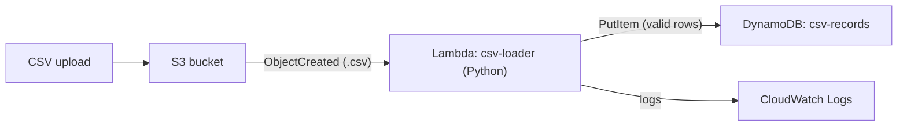

# Serverless CSV Loader
# Serverless CSV Loader (AWS)

An event-driven pipeline on AWS: when a CSV file is uploaded to S3, a Lambda function validates each row and loads the valid ones into DynamoDB. Invalid rows are logged and skipped.

## Architecture



## How it works
1. A `.csv` file is uploaded to a private S3 bucket.
2. S3 sends an event notification that invokes the Lambda function asynchronously.
3. The function reads the file, checks each row, and writes valid rows to DynamoDB.
4. Rows that fail validation are logged to CloudWatch and skipped.

**Validation rules:** `id` must be present, `email` must be present and contain `@`, and `amount` must be a number.

## AWS services and why
| Service | Role |
|---|---|
| S3 | Private storage for uploaded files; emits the upload event |
| Lambda (Python) | Runs the validation and load logic on demand, no servers to manage |
| DynamoDB (provisioned, partition key `id`) | Stores valid records with fast key-based access |
| IAM | Least-privilege execution role for the function |
| CloudWatch Logs | Logs and visibility into each run |

## Security
- The bucket blocks all public access.
- The Lambda execution role allows only `s3:GetObject` on this bucket and `dynamodb:PutItem` on this table (least privilege):

```json
{
  "Version": "2012-10-17",
  "Statement": [
    { "Effect": "Allow", "Action": ["s3:GetObject"],
      "Resource": "arn:aws:s3:::YOUR_BUCKET_NAME/*" },
    { "Effect": "Allow", "Action": ["dynamodb:PutItem"],
      "Resource": "arn:aws:dynamodb:REGION:ACCOUNT_ID:table/csv-records" }
  ]
}
```

## Design decisions
- **Idempotent writes:** `put_item` overwrites by `id`, so re-uploading a file does not create duplicates.
- **Clients created outside the handler** so warm invocations reuse them.
- **Table name in an environment variable** (`TABLE_NAME`), not hard-coded.
- **Decimal for amounts**, because DynamoDB does not accept Python floats.
- **Suffix filter (`.csv`)** on the S3 trigger so other files do not invoke the function.

## Tested scenarios
| Input | Result |
|---|---|
| `data/sample.csv` | 2 valid rows loaded, 2 invalid rows skipped and logged |
| Same file uploaded twice | No duplicates (idempotent) |
| `data/empty.csv` | `loaded=0, skipped=0`, no error |
| `data/wrong_columns.csv` | Row skipped (missing id) |
| `data/update.csv` | Existing item updated, new item added |
| Non-`.csv` file | Function not invoked |
| Corrupt binary `.csv` | Function errors; Lambda retries twice, then the event is dropped |

## Known limitations and next steps
- [ ] SQS dead-letter queue and alarms so failed files are not lost silently
- [ ] Query API (API Gateway + Lambda)
- [ ] Infrastructure as code (AWS SAM) and CI/CD (GitHub Actions)
- [ ] Unit tests for the validation logic

## Project layout
```
src/lambda_function.py   Lambda handler
data/                    Sample CSV files for testing
```