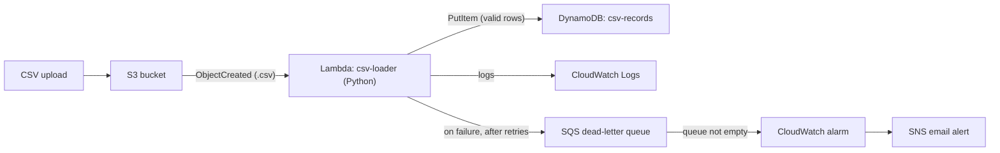

# Serverless CSV Loader (AWS)

An event-driven, fault-tolerant pipeline on AWS: when a CSV file is uploaded to S3, a Lambda function validates each row and loads valid ones into DynamoDB. Invalid rows are logged and skipped. If processing fails, the failed event is kept in an SQS dead-letter queue and an alarm sends an email alert.

## Architecture



## How it works
1. A `.csv` file is uploaded to a private S3 bucket.
2. S3 sends an event notification that invokes the Lambda function asynchronously.
3. The function reads the file, checks each row, and writes valid rows to DynamoDB.
4. Rows that fail validation are logged to CloudWatch and skipped.
5. If the function itself fails (for example, a corrupt file), Lambda retries twice, then sends a failure record to an SQS queue (retained for 14 days).
6. A CloudWatch alarm watches the queue and notifies an SNS topic by email when it is not empty.

**Validation rules:** `id` must be present, `email` must be present and contain `@`, and `amount` must be a number.

## AWS services and why
| Service | Role |
|---|---|
| S3 | Private storage for uploaded files; emits the upload event |
| Lambda (Python) | Runs the validation and load logic on demand, no servers to manage |
| DynamoDB (provisioned, partition key `id`) | Stores valid records with fast key-based access |
| SQS | Dead-letter queue that keeps failed events for inspection and replay |
| CloudWatch | Logs, plus an alarm on the dead-letter queue |
| SNS | Email notification when the alarm fires |
| IAM | Dedicated, least-privilege execution role for the function |

## Security
- The bucket blocks all public access.
- The function has its own execution role (basic logging policy plus an inline policy) allowing only `s3:GetObject` on this bucket, `dynamodb:PutItem` on this table, and `sqs:SendMessage` on the dead-letter queue:

```json
{
  "Version": "2012-10-17",
  "Statement": [
    { "Effect": "Allow", "Action": ["s3:GetObject"],
      "Resource": "arn:aws:s3:::YOUR_BUCKET_NAME/*" },
    { "Effect": "Allow", "Action": ["dynamodb:PutItem"],
      "Resource": "arn:aws:dynamodb:REGION:ACCOUNT_ID:table/csv-records" },
    { "Effect": "Allow", "Action": ["sqs:SendMessage"],
      "Resource": "arn:aws:sqs:REGION:ACCOUNT_ID:csv-loader-dlq" }
  ]
}
```

## Design decisions
- **Idempotent writes:** `put_item` overwrites by `id`, so re-uploading a file does not create duplicates.
- **On-failure destination (SQS)** instead of the older DLQ setting, so the failure record includes error details as well as the original event.
- **Clients created outside the handler** so warm invocations reuse them.
- **Table name in an environment variable** (`TABLE_NAME`), not hard-coded.
- **Decimal for amounts**, because DynamoDB does not accept Python floats.
- **Suffix filter (`.csv`)** on the S3 trigger so other files do not invoke the function.

## Tested scenarios
| Input | Result |
|---|---|
| `data/sample.csv` | 2 valid rows loaded, 2 invalid rows skipped and logged |
| Same file uploaded twice | No duplicates (idempotent) |
| `data/empty.csv` | `loaded=0, skipped=0`, no error |
| `data/wrong_columns.csv` | Row skipped (missing id) |
| `data/update.csv` | Existing item updated, new item added |
| Non-`.csv` file | Function not invoked |
| Corrupt binary `.csv` | Function fails and is retried twice; the failure record lands in the SQS queue, the alarm fires, and an email alert is sent |

## Next steps
- [ ] Query API (API Gateway + Lambda)
- [ ] Infrastructure as code (AWS SAM) and CI/CD (GitHub Actions)
- [ ] Unit tests for the validation logic
- [ ] Tooling to replay messages from the dead-letter queue

## Project layout
```
src/lambda_function.py   Lambda handler
data/                    Sample CSV files for testing
```